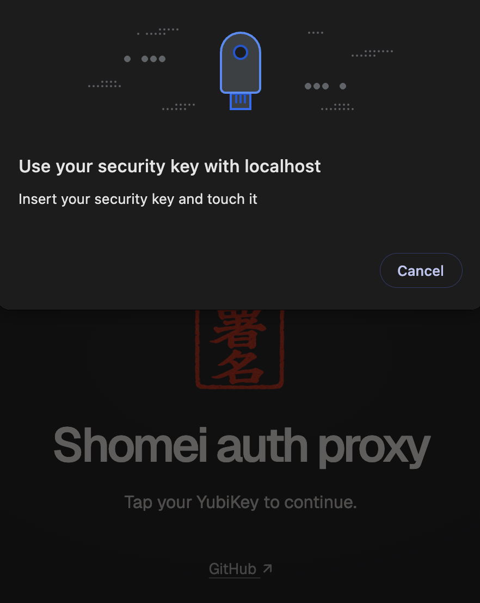

#  Shomei

Shomei (署名, Japanese for “signature”) is a Rust authentication proxy for HTTP and TCP backed by hardware-attested YubiKeys.

- **Reverse proxy** supports browser WebAuthn, one-use CLI assertions, and encrypted session cookies for HTTP. Configured TCP targets use short-lived mTLS certificates.
- **Forward proxy** uses YubiKey assertions or sessions for HTTP and HTTPS, and short-lived mTLS certificates for TCP and SSH.
- **Tailscale SSH** can require YubiKey approval before a direct connection from the caller’s device.

All enrolled keys authenticate as `shomei`. The default policy requires a supported YubiKey 5 Series key with firmware 5.7.4 or later, PIN, and touch.

<p align="center">
  
</p>

## Quickstart

Start a local deploy app behind Shomei and approve a deploy with your YubiKey. Run the commands in an empty directory with Docker Compose installed. The bundled TLS key is public and for loopback demos only. Use `init --u2f` for a YubiKey 4. Once Compose is up, you can also click Deploy in a browser that trusts `fixtures/localhost/ca.pem`. [Open the deploy demo](https://localhost:8443/)

```sh
curl -fsSL https://raw.githubusercontent.com/adrianchifor/shomei/main/install.sh | sh
curl -fsSL https://github.com/adrianchifor/shomei/releases/latest/download/shomei-deploy-example.tar.gz | tar -xz

shomei="$HOME/.local/bin/shomei"
ca=fixtures/localhost/ca.pem
deploy=https://localhost:8443/api/deploy
mkdir -m 0755 -p local/config
"$shomei" init
"$shomei" get-id > local/config/identities.json
chmod 0644 local/config/identities.json
docker compose -f compose.deploy.yaml up --wait

curl -si --cacert "$ca" -X POST "$deploy" # 401 Unauthorized
approval="$("$shomei" sign --ca-file "$ca")" && curl -fsS --cacert "$ca" \
  -H "Authorization: Shomei $approval" -X POST "$deploy"
# Enter your PIN if prompted and touch your YubiKey. Expect HTTP 200 with the new deploy revision.
```

## SSH demo

Run this demo in a repository checkout. Stop the deploy demo with `docker compose -f compose.deploy.yaml down`, then copy its `local/config/identities.json` into the checkout at the same path. Use the public key that matches your OpenSSH identity.

```sh
sh fixtures/ssh/setup.sh "$HOME/.ssh/id_ed25519.pub"
docker compose -f compose.ssh.yaml up --wait
"$HOME/.local/bin/shomei" ssh --proxy tls://localhost:9443 --ca-file fixtures/localhost/ca.pem \
  --ssh-arg=-o --ssh-arg="UserKnownHostsFile=$PWD/local/ssh/known_hosts" \
  --ssh-arg=-o --ssh-arg=StrictHostKeyChecking=yes ubuntu@deploy -- id -un
```

`ubuntu` is the OpenSSH login user. `deploy` matches `tcp.ssh_host` in the gateway config, and `tcp.upstream` sets the actual SSH destination. In this demo that destination is `127.0.0.1:2222` inside the gateway network namespace. [SSH demo configuration](fixtures/ssh/shomei.toml)

Approve with your YubiKey. The command prints `ubuntu`. Omit `-- id -un` for an interactive shell.

Stop the demo with `docker compose -f compose.ssh.yaml down`.

## Configure your own upstream

Save the example configuration as `local/config/shomei.toml`, set your origin and upstreams, and create a writable `local/state`. Save the Compose file alongside `local/` and run `docker compose up -d` to start `ghcr.io/adrianchifor/shomei:latest`. Keep upstream listeners private. [Compose file](compose.yaml) · [Example configuration](shomei.example.toml)

| Setting | Purpose |
| --- | --- |
| `origin` | Public HTTPS origin, including a nondefault port. Enroll keys for this origin. |
| `tls_cert`, `tls_key` | Gateway TLS certificate and private key. |
| `http_upstream` | HTTP or HTTPS origin to forward to. |
| `tcp.upstream` | Fixed TCP host and port. Set `tcp.ssh_host` to the alias used by `shomei ssh`. |
| `[forward]` | Forward listeners for signed HTTP traffic and mTLS TCP traffic, with named destination scopes. |
| `session_ttl_seconds` | HTTP session lifetime. Defaults to 600 seconds. |
| `tcp.cert_ttl_seconds` | mTLS certificate lifetime. Defaults to 300 seconds. Active relays close at expiry. |
| `protected_paths` | Require fresh approval for selected reverse-proxy paths and leave others public. |
| `[limits]` | Connection, request, and challenge limits. |

Put one `shomei get-id` token per line in the identity file. Use `#` on its own line or after a token to label a key, for example `shomei-id-v1:… # alice`. All keys use the `shomei` account. Shomei decodes the compressed records in memory and verifies their hardware attestation. Existing JSON arrays also work. Use `shomei get-id --json` for JSON-based tooling. [Convert an existing allowlist](AGENTS.md#enroll-a-key)

Replace the identity file atomically to reload the allowlist. Removing or replacing a key revokes existing HTTP sessions and TCP relay access. Restarting the proxy invalidates its session cookies.

To protect only selected paths and leave the rest public, route those paths through Shomei at your ingress. Keep the protected backend private. A Shomei reverse proxy requires authentication for all paths it serves.

### Protect selected endpoints

Set `protected_paths` alongside `http_upstream` to make the rest of the site public. Listed paths, descendants, and format suffixes such as `/api/deploy.json` require a fresh approval. Matching is case-insensitive. Ambiguous paths also require approval. Add any other paths that the application routes to the same handler.

```toml
http_upstream = "http://app:8080"
protected_paths = ["/api/deploy"]
```

The app controls the action and its payload. A browser app can use the WebAuthn helper to attach an assertion to its request. CLI clients can run `shomei sign` and send the result in `Authorization: Shomei <assertion>`. [Deploy demo script](fixtures/deploy/deploy.js)

Omit `protected_paths` to require authentication across the site. Unauthenticated HTML GETs open the login page, and unauthenticated API requests receive `401`. A valid session authorizes subsequent site requests.

### Share a gateway across services

One Shomei gateway serves one public HTTPS origin and forwards HTTP to one upstream. Point `http_upstream` at a private router to serve multiple sites and APIs under that origin. For example, the router can send `/dashboard` and `/api/deploy` to different services.

One enrollment covers those routes and an SSH upstream configured on the same gateway. For separate public HTTPS origins, use a separate gateway configuration and enroll a credential for each origin. You can use the same physical YubiKey for each enrollment.

## Forward to a fleet

Enable `[forward]` and define `[forward.scopes.fleet]` with permitted CIDRs and ports. Add `dns_suffixes` to require matching DNS names in those ranges. Shomei resolves destinations on the gateway and connects only to matching addresses. Every enrolled YubiKey can approve any configured scope. [Example configuration](shomei.example.toml)

Shomei selects the scope automatically when there's only one. Specify `--scope NAME` when there are multiple. To rely on your gateway's outbound network policy, configure a scope with `allow_all = true` and omit `cidrs`, `ports`, and `dns_suffixes`. It permits any reachable destination and port for TCP and HTTP. HTTPS tunnels still check `https_ports`, which defaults to `[443]`.

Set `forward.http_bind` to `0.0.0.0:9445` to enable HTTP forwarding. Each signed assertion approves one HTTP request or one HTTPS tunnel. Add `--session` to reuse that approval until `session_ttl_seconds` expires.

```sh
gateway=https://shomei.example.com:8443
approval="$(shomei sign --proxy "$gateway" --forward)" &&
  curl --proxy https://shomei.example.com:9445 \
    --proxy-header "Proxy-Authorization: Shomei $approval" \
    https://status.internal.example.com/

session="$(shomei sign --proxy "$gateway" --forward --session)" &&
  curl --proxy https://shomei.example.com:9445 \
    --proxy-header "Proxy-Authorization: Shomei-Session $session" \
    http://reports.internal.example.com/today
```

HTTPS stays encrypted through the tunnel. The proxy authorizes the destination when the tunnel opens. A deploy behind the reverse proxy can still ask for a fresh browser WebAuthn approval for each write. [curl proxy options](https://curl.se/docs/manpage.html#--proxy-header)

For TCP and SSH, approve a reusable mTLS certificate for the scope.

```sh
shomei mtls --proxy "$gateway" --out ./fleet-cert
shomei ssh --proxy "$gateway" --credentials ./fleet-cert ubuntu@host.internal.example.com
shomei connect --credentials ./fleet-cert --listen 127.0.0.1:15432 db.internal.example.com:5432
# While connect is running, point your TCP client at 127.0.0.1:15432.
```

For an in-memory certificate, omit `--credentials` with `connect` or use `ssh --forward`. Forward TCP certificates default to five minutes. Sessions and certificates expire on allowlist revocation or gateway restart. Active tunnels close when access expires.

## Tailscale SSH

Shomei verifies a YubiKey, sets a temporary posture attribute on the calling device, and starts OpenSSH to the requested host. Tailscale's policy controls which hosts the device can reach during that window and applies its SSH re-authentication rules. This mode requires Tailscale Premium or Enterprise. [Setup and policy example](AGENTS.md#approve-direct-tailscale-ssh)

```sh
shomei ssh --tailscale --proxy https://shomei.example.ts.net:8443 ubuntu@deploy.example.ts.net
```
